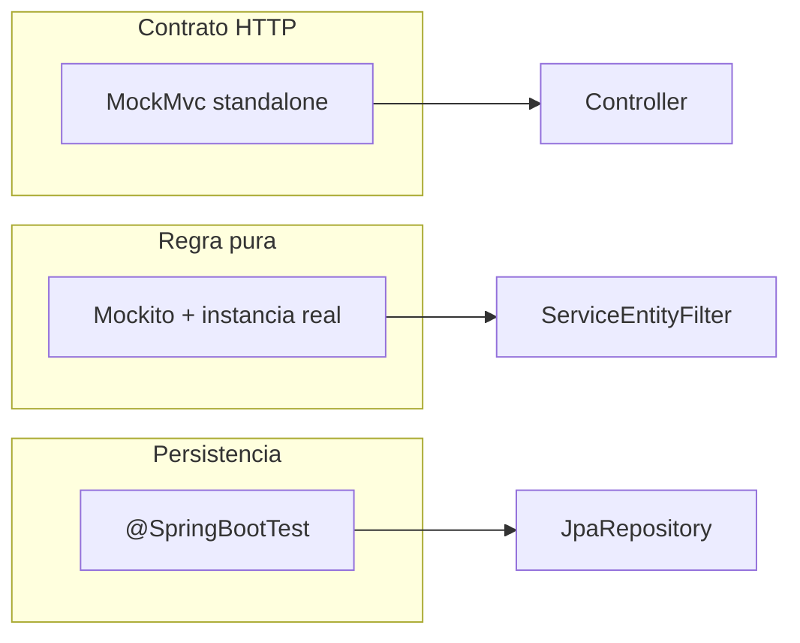

# Testes unitários do backend

Documentação das suítes em `backend/src/test/java`. Cada arquivo de classe nesta pasta segue o layout de 7 seções (informações gerais, objetivo, cenários, exceção e borda, mocks, cobertura, observações). O índice abaixo aponta para esses documentos.

Alinhado aos seams descritos em [`.cursor/skills/tdd/reference.md`](../../skills/tdd/reference.md).

## Objetivo

Os testes observam **comportamento pela interface pública** (HTTP, serviço, entidade ou repositório). Colaboradores externos são substituídos por mocks na **borda** (ports, repositories), não por detalhes internos da classe sob teste.

## Três padrões (seams)



| Seam | Anotações / ferramentas | Quando usar |
|------|-------------------------|-------------|
| Contrato HTTP | `@ExtendWith(MockitoExtension.class)`, `MockMvcBuilders.standaloneSetup`, `@Mock` no service | Controllers e `@ControllerAdvice` |
| Regra pura | `@ExtendWith(MockitoExtension.class)`, instância `new Service(...)`, `@Mock` nos ports | Services, entidades, filtros servlet |
| Persistência | `@SpringBootTest`, `@Autowired` no repository, `@MockitoBean` em beans que o contexto sobe mas o teste não usa | Adaptadores JPA |

## Executar uma suíte (Windows)

```powershell
Set-Location backend
.\mvnw.cmd -Dtest=NomeDaClasseTest test
```

Exemplo: `.\mvnw.cmd -Dtest=LoginServiceTest test`

## Testes que precisam de PostgreSQL

Com `spring.flyway.enabled=false` ainda é necessário **JDBC** para subir o contexto Spring:

- [Ecovolt360ApplicationTests.md](Ecovolt360ApplicationTests.md)
- [JpaUserRepositoryIntegrationTest.md](JpaUserRepositoryIntegrationTest.md)

Na raiz do repositório: `docker compose up`.

## Índice por módulo

### Auth

| Documento | Classe de teste |
|-----------|-----------------|
| [Ecovolt360ApplicationTests.md](Ecovolt360ApplicationTests.md) | Smoke do contexto Spring |
| [JpaUserRepositoryIntegrationTest.md](JpaUserRepositoryIntegrationTest.md) | `UserRepository` + JDBC |
| [LoginControllerTest.md](LoginControllerTest.md) | Login e sessão HTTP |
| [LoginServiceTest.md](LoginServiceTest.md) | Credenciais e logout |
| [JwtTokenVerifierTest.md](JwtTokenVerifierTest.md) | Validação JWT |
| [JwtAuthenticationFilterTest.md](JwtAuthenticationFilterTest.md) | Filtro Bearer |
| [UserTest.md](UserTest.md) | Entidade `User` |

### Customer

| Documento | Classe de teste |
|-----------|-----------------|
| [CustomerControllerTest.md](CustomerControllerTest.md) | Cadastro e validação de senha |
| [CustomerServiceTest.md](CustomerServiceTest.md) | Regras de registro |
| [CustomerExceptionHandlerTest.md](CustomerExceptionHandlerTest.md) | Erros HTTP do módulo customer |

### Ticket

| Documento | Classe de teste |
|-----------|-----------------|
| [TicketTest.md](TicketTest.md) | Entidade `Ticket` |
| [TicketServiceTest.md](TicketServiceTest.md) | Regras de tickets (maior suíte) |
| [CustomerTicketControllerTest.md](CustomerTicketControllerTest.md) | API cliente |
| [SupportTicketControllerTest.md](SupportTicketControllerTest.md) | API suporte |

### Messages

| Documento | Classe de teste |
|-----------|-----------------|
| [MessageServiceTest.md](MessageServiceTest.md) | Criação de mensagens |
| [MessageControllerTest.md](MessageControllerTest.md) | API de mensagens |
